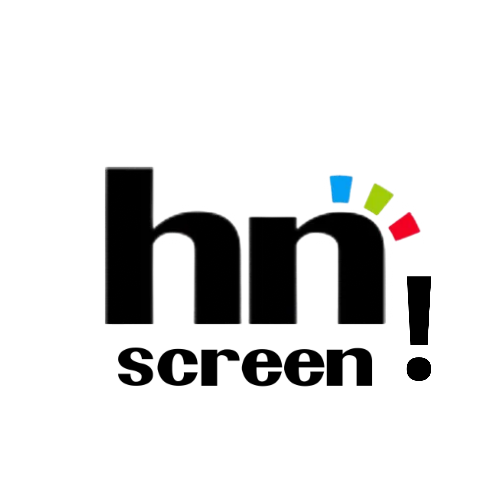

<p align="center"></p>

# Hn screen !

L'album de tes captures d'écran Nintendo 3DS, façon menu HOME, par [Heivoli Network](https://heivoli-network.fr/logiciels.html).

- Captures rangées par jeu et par date, écrans du haut et du bas
- Compatible avec les captures de Rosalina (L + ↓ + Select)
- Partage par QR code : la capture s'ouvre sur heivoli-network.fr pendant 24 h
- Partage en Wi-Fi local si le site ne répond pas
- Mises à jour automatiques au lancement

## Télécharger

- **CIA (conseillé)** : <https://raw.githubusercontent.com/Heivoli-dev/hn-screen/builds/hn-screen.cia>
  Installe-le avec FBI (ou « Remote Install » › « Scan QR Code »).
- **3DSX** : <https://raw.githubusercontent.com/Heivoli-dev/hn-screen/builds/hn-screen.3dsx>
  À lancer depuis le Homebrew Launcher.

## Compiler

Chaque envoi sur `main` compile l'appli avec GitHub Actions et publie le `.cia`, le `.3dsx`
et `version.txt` sur la branche `builds`. Les consoles y trouvent leurs mises à jour.

En local : devkitPro (`3ds-dev`, `3ds-curl`), le fichier <https://curl.se/ca/cacert.pem> dans `romfs/`, puis

```
make        # hn-screen.3dsx
make cia    # hn-screen.cia (makerom dans le PATH)
```

Les numéros de build commencent à 101 : l'ancien dépôt s'arrêtait à la build 11.
